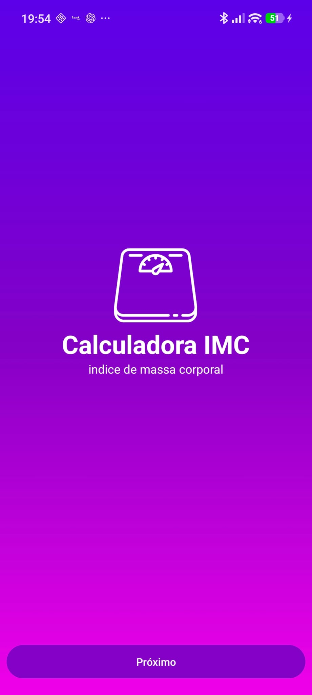
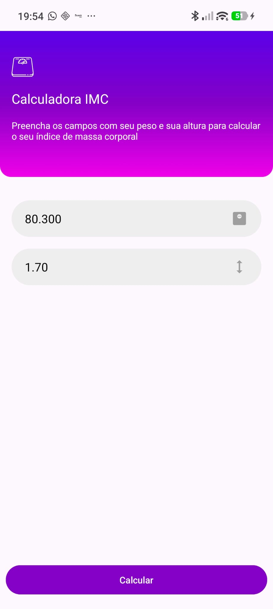
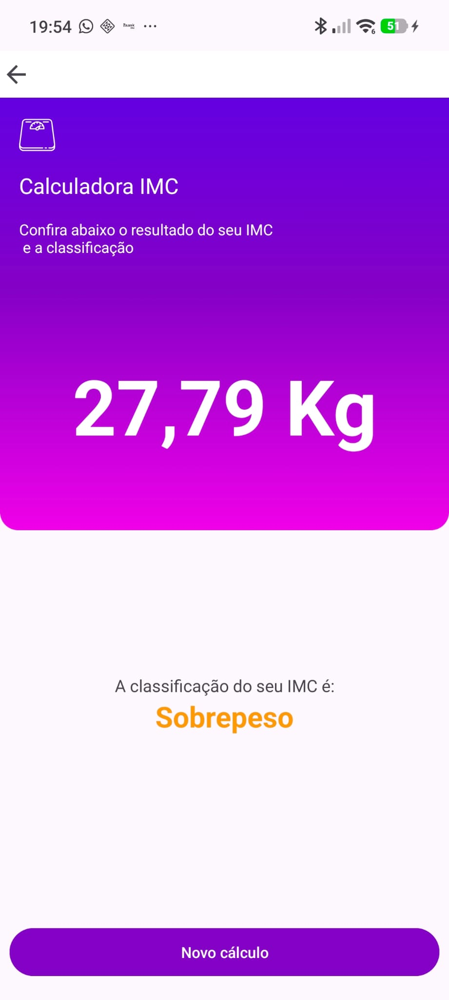
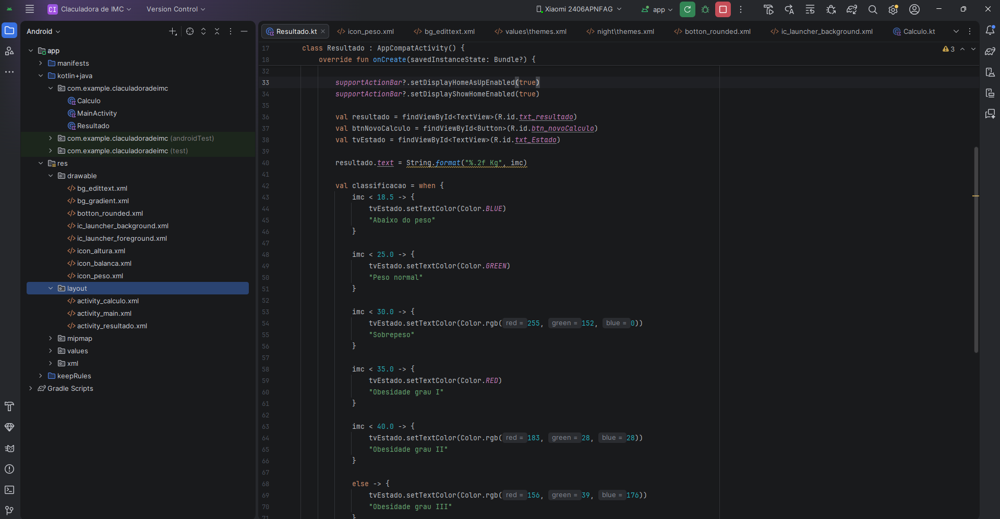

# Calculadora de IMC — Android com Kotlin

Aplicativo Android para calcular o Índice de Massa Corporal (IMC) a partir do peso e da altura informados pelo usuário. O resultado é apresentado com duas casas decimais e uma classificação destacada por cores.

Desenvolvi este projeto como parte dos meus estudos em desenvolvimento Android, praticando Kotlin, interfaces em XML e navegação entre telas.

## Telas do aplicativo

| Apresentação | Peso e altura | Resultado |
| :---: | :---: | :---: |
|  |  |  |

## Funcionalidades

- **Tela de apresentação:** identidade visual com ícone de balança, fundo em degradê e botão para iniciar.
- **Entrada de dados:** campos para informar peso em quilogramas e altura em metros, com ícones e bordas arredondadas.
- **Cálculo do IMC:** cálculo a partir dos valores informados.
- **Resultado formatado:** exibição do valor com duas casas decimais.
- **Classificação por faixa:** texto e cor definidos conforme o resultado.
- **Novo cálculo:** botão para realizar outra consulta.
- **Navegação:** fluxo entre apresentação, formulário e resultado, com opção de voltar na tela de resultado.

## Como usar

1. Abra o aplicativo e toque em **Próximo**.
2. Informe o peso em quilogramas e a altura em metros.
3. Toque em **Calcular**.
4. Consulte o resultado e a classificação exibida.
5. Toque em **Novo cálculo** para começar novamente.

## Cálculo utilizado

```text
IMC = peso / (altura × altura)
```

No exemplo dos prints, o peso informado é **80,300 kg** e a altura é **1,70 m**:

```text
80,300 / (1,70 × 1,70) ≈ 27,79
```

O aplicativo apresenta a classificação **Sobrepeso** para esse resultado.

## Classificações implementadas

As faixas abaixo descrevem a lógica utilizada no código do aplicativo:

| Faixa de IMC | Texto exibido | Cor |
| --- | --- | --- |
| Menor que 18,5 | Abaixo do peso | Azul |
| De 18,5 a menos de 25 | Peso normal | Verde |
| De 25 a menos de 30 | Sobrepeso | Laranja |
| De 30 a menos de 35 | Obesidade grau I | Vermelho |
| De 35 a menos de 40 | Obesidade grau II | Vermelho escuro |
| A partir de 40 | Obesidade grau III | Roxo |

## Tecnologias e recursos utilizados

| Tecnologia ou recurso | Aplicação no projeto |
| --- | --- |
| Kotlin | Lógica do aplicativo e classificação do resultado. |
| Android Studio | Desenvolvimento das telas e execução no dispositivo Android. |
| XML e Android Views | Construção das interfaces. |
| AppCompatActivity | Base das telas do aplicativo. |
| `findViewById` | Acesso aos componentes definidos nos layouts XML. |
| EditText | Entrada de peso e altura. |
| TextView e Button | Exibição de textos, resultado e ações da interface. |
| Expressão `when` | Seleção da classificação de acordo com o IMC. |
| `setTextColor`, `Color` e `Color.rgb` | Aplicação de cores diferentes às classificações. |
| `String.format` | Formatação do resultado com duas casas decimais. |
| ActionBar | Exibição do botão de voltar na tela de resultado. |
| Drawables XML | Fundos em degradê, campos e botões arredondados e ícones. |

## Organização do projeto

| Arquivo | Responsabilidade |
| --- | --- |
| `MainActivity.kt` | Tela de apresentação. |
| `Calculo.kt` | Tela de entrada de peso e altura e fluxo de cálculo. |
| `Resultado.kt` | Apresentação do resultado e classificação por cores. |
| `activity_main.xml` | Layout da apresentação. |
| `activity_calculo.xml` | Layout do formulário. |
| `activity_resultado.xml` | Layout do resultado. |
| `bg_gradient.xml` | Fundo em degradê. |
| `bg_edittext.xml` | Aparência dos campos de entrada. |
| `botton_rounded.xml` | Aparência dos botões arredondados. |
| `icon_balanca.xml`, `icon_peso.xml` e `icon_altura.xml` | Ícones utilizados na interface. |

## Como executar

1. Clone ou baixe este repositório.
2. Abra a pasta raiz do projeto no Android Studio.
3. Aguarde a sincronização do Gradle e instale os componentes do SDK solicitados pelo projeto.
4. Selecione um emulador ou conecte um dispositivo Android com a depuração USB ativada.
5. Execute o módulo `app` pelo botão **Run ▶**.

## Aprendizados

Durante o desenvolvimento, pratiquei a construção de interfaces em XML, o uso de campos numéricos, operações matemáticas em Kotlin e a apresentação dos resultados em outra tela.

Também trabalhei com condições usando `when`, formatação de números, personalização de cores e criação de fundos e botões com drawables XML.

## Registro do desenvolvimento

O print abaixo mostra a implementação da classificação por faixas e da alteração das cores no Android Studio.



## Ajuste visual pendente

Os prints mostram o resultado acompanhado de `Kg`. A unidade do IMC é **kg/m²**; a legenda deverá ser ajustada no aplicativo. As imagens registram a versão atual.

## Autor

Desenvolvido por **André Santos**, como projeto de estudo em desenvolvimento Android com Kotlin.
